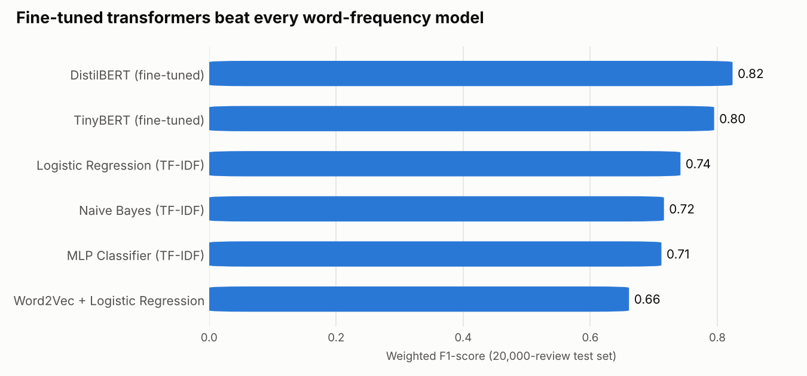
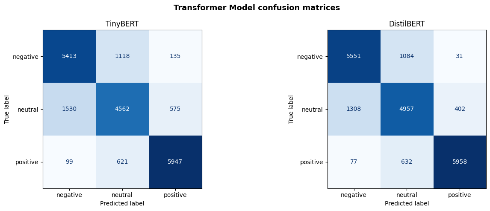
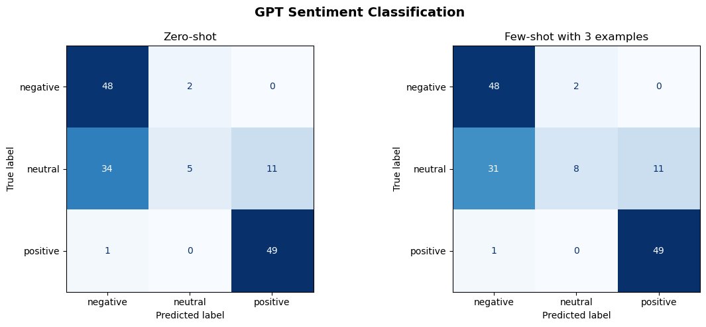
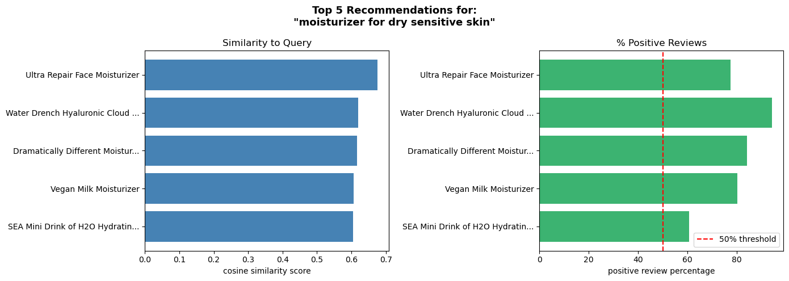
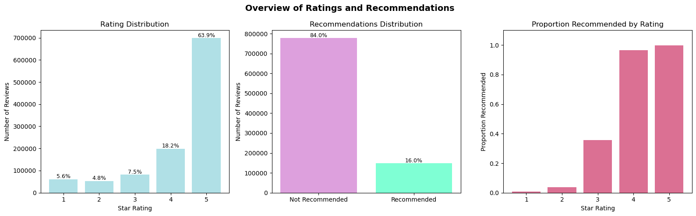

# Sentiment Classification of Sephora Skincare Reviews: from Bag-of-Words to BERT

How well can NLP models read the sentiment of real skincare reviews, and do context-aware models actually beat simple word-frequency models? This project compares eight approaches on **1.09 million Sephora reviews**: TF-IDF classifiers, Word2Vec, fine-tuned TinyBERT and DistilBERT, and GPT-5-mini prompting. It also prototypes a **review-based product recommender**.

> MSc Business Administration and Data Science, Natural Language Processing and Text Analytics exam project (Spring 2026). Team project by 4 students.



## Research question

**To what extent can NLP models accurately classify the sentiment of skincare product reviews, and do context-aware models add value over classical word-frequency models?**

## Key results

All models were tested on the same 20,000-review test set (balanced: negative / neutral / positive).

| Model | Text representation | Accuracy | Weighted F1 |
|---|---|---:|---:|
| Word2Vec + Logistic Regression | averaged word vectors | 0.661 | 0.661 |
| MLP Classifier (2 × 100) | TF-IDF (1–2-grams) | 0.713 | 0.712 |
| Multinomial Naive Bayes | TF-IDF (1–2-grams) | 0.716 | 0.716 |
| Logistic Regression | TF-IDF (1–2-grams) | 0.743 | 0.742 |
| TinyBERT (fine-tuned) | contextual embeddings | 0.796 | 0.795 |
| **DistilBERT (fine-tuned)** | **contextual embeddings** | **0.823** | **0.824** |

- **Context matters.** Fine-tuned DistilBERT beats the best classical model by about 8 percentage points of F1, because it reads the whole sentence and handles negation and mixed opinions.
- **A more complex classifier doesn't help when the features have no context.** The MLP did no better than linear models on the same TF-IDF features.
- **Word2Vec came last.** Averaging word vectors loses word order, so "not good" and "very good" end up looking alike. TF-IDF bigrams keep them apart.
- **Neutral (3-star) reviews are the hardest class for every model.** They mix praise and complaints, so they're mostly confused with negative reviews.
- **Longer reviews are misclassified more often than short ones** (DistilBERT error analysis), because they tend to be more nuanced.



### LLM prompting (GPT-5-mini)

Tested separately on 150 reviews (50 per class) through the OpenAI API, so the numbers aren't directly comparable with the table above:

| Strategy | Accuracy | Weighted F1 |
|---|---:|---:|
| Zero-shot | 0.68 | 0.60 |
| Few-shot | 0.70 | 0.63 |
| Chain-of-thought | 0.74 | 0.74 |

GPT was close to perfect on clearly positive and negative reviews, but zero- and few-shot prompting almost never predicted "neutral". Chain-of-thought with an explicit "mixed = neutral" rule fixed that, but then labelled half of the negative reviews as neutral.



## Product recommender prototype

A content-based recommender that matches a free-text query (e.g. *"lightweight sunscreen that doesn't leave a white cast"*) against **what customers wrote** about each product, not the product metadata:

1. All reviews of each product are merged into one document (2,351 products).
2. The documents are vectorised with TF-IDF (10,000 terms).
3. The query is ranked against every product by **cosine similarity**, and the top 5 are returned.
4. Each result shows brand, price and the **% of reviews classified as positive** by the sentiment model.



## Data

[Sephora Products and Skincare Reviews](https://www.kaggle.com/datasets/nadyinky/sephora-products-and-skincare-reviews) (Kaggle): real reviews scraped from Sephora's website.
- `product_info.csv`: 8,494 products with brand, price, category and ingredients
- 5 review files, 1,094,411 reviews in total, with text, star rating, recommendation flag and reviewer attributes

**Labels:** 1–2 stars → negative, 3 → neutral, 4–5 → positive. The raw data is heavily skewed (over 80% positive), so a **balanced sample of 100,000 reviews** (33,333 per class, random undersampling) was used for modelling.



The data files (~600 MB) are not stored in this repo. Download them from Kaggle to run the notebooks.

## Methodology

1. **EDA:** product popularity vs rating, brand and ingredient effects, rating distribution, and review length by rating.
2. **Preprocessing (two pipelines):**
   - *Classical models:* lowercase → remove URLs, punctuation and digits → tokenize → remove stopwords → lemmatize (NLTK)
   - *Transformers:* minimal cleaning (URLs and whitespace only), keeping stopwords and negations like "not" because BERT needs full sentences
3. **Classical models:** TF-IDF (10k features, unigrams + bigrams) with Naive Bayes, Logistic Regression and an MLP. Word2Vec (Skip-Gram, 100-d, trained on the corpus) with Logistic Regression.
4. **Transformers:** TinyBERT and DistilBERT (Hugging Face) fine-tuned for 3 epochs, batch 32, learning rate 2e-5, max length 200, on a Colab T4 GPU.
5. **LLM prompting:** GPT-5-mini with zero-shot, few-shot and chain-of-thought prompts.
6. **Evaluation:** accuracy, precision, recall, weighted F1, confusion matrices and error analysis.
7. **Recommender:** TF-IDF + cosine similarity over product-level review documents, enriched with sentiment scores.

## Repository structure

```
├── notebooks/
│   ├── 01_eda_classical_models_gpt_recommender.ipynb  # EDA, preprocessing, TF-IDF/Word2Vec models, GPT prompting, recommender
│   └── 02_bert_finetuning_colab.ipynb                 # TinyBERT & DistilBERT fine-tuning + error analysis (Colab, GPU)
├── report/
│   └── Sephora_Sentiment_Classification_report.pdf
└── images/                                            # figures used in this README
```

## How to run

1. Download the dataset from [Kaggle](https://www.kaggle.com/datasets/nadyinky/sephora-products-and-skincare-reviews) and put the CSV files in the `notebooks/` folder.
2. Install the dependencies:
   ```bash
   pip install pandas numpy matplotlib seaborn nltk scikit-learn gensim wordcloud openai
   ```
3. Run `01_eda_classical_models_gpt_recommender.ipynb`. It creates `reviews_sample_balanced.csv`, which the second notebook uses.
4. For the GPT section, set your own API key as an environment variable first:
   ```bash
   export OPENAI_API_KEY="your-key-here"
   ```
5. Open `02_bert_finetuning_colab.ipynb` in **Google Colab** with a GPU runtime, upload `reviews_sample_balanced.csv`, and run all cells.

## Tech stack

Python · pandas · NLTK · scikit-learn · Gensim (Word2Vec) · PyTorch · Hugging Face Transformers · OpenAI API · matplotlib · seaborn · Jupyter/Colab

## Team

This was a team project by four students, completed as the final exam project for the Natural Language Processing and Text Analytics course in the MSc Business Administration and Data Science programme (Spring 2026). The analysis, modelling and report were developed together as a group.

---
*Data: Sephora Products and Skincare Reviews by Nady Inky, Kaggle (2023).*
